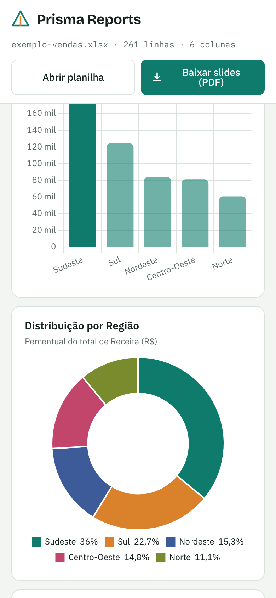

<p align="center">
  
</p>

<h1 align="center">Prisma Reports — relatórios visuais a partir de planilhas</h1>

<p align="center">
  Envie um <strong>Excel ou CSV</strong> e receba na hora um relatório com indicadores, percentuais e gráficos.<br />
  Com um clique, o relatório vira uma apresentação de slides em PDF.
</p>

<p align="center">
  <strong>Português</strong> · <a href="README.en.md">English</a> · <a href="README.es.md">Español</a>
</p>

<p align="center">
  
  
  
  
  
</p>


## Sobre o projeto

O Prisma Reports transforma uma planilha em um relatório visual sem que ninguém precise
montar gráficos à mão. A pessoa envia o arquivo, escolhe o que quer analisar e baixa o
resultado pronto para apresentar, no formato de slides em PDF.

A inspiração é o [beautiful.ai](https://www.beautiful.ai/): slides bonitos com layouts que
se ajustam sozinhos ao conteúdo, aqui alimentados pelos dados da planilha.

Tudo roda no navegador. Os dados não são enviados a nenhum servidor.

### Objetivos

- Ler qualquer planilha com cabeçalho na primeira linha, sem configuração.
- Mostrar os números mais importantes de forma clara e visual.
- Deixar a pessoa mudar a análise (agrupamento, valor, cálculo) e ver o resultado na hora.
- Gerar uma apresentação em PDF pronta para enviar ou apresentar.

## Funcionalidades

- **Upload de Excel e CSV:** `.xlsx`, `.xls` e `.csv`, arrastando o arquivo para a página
  ou pelo botão **Abrir planilha**. Planilhas com várias abas mostram um seletor de aba.
- **Detecção automática das colunas:** cada coluna é reconhecida como número, data,
  categoria ou texto, inclusive no formato brasileiro (`1.234,56`, `R$ 10,00`,
  `dd/mm/aaaa`). CSV com `;`, `,` ou tabulação, em UTF-8 ou Windows-1252.
- **Indicadores:** total de linhas, soma e média do valor escolhido, número de grupos e
  maior grupo.
- **Anéis de percentual:** a participação de cada grupo no total.
- **Gráficos:** barras por grupo, rosca com a distribuição e linha do tempo por mês.
- **Destaques automáticos:** frases curtas com o líder, a concentração dos maiores
  grupos, a variação do último mês e o melhor mês.
- **Análise dinâmica:** escolha por qual coluna agrupar, qual valor somar e se o cálculo
  é soma, média ou contagem. Tudo se atualiza na hora.
- **Slides em PDF:** apresentação 16:9 com capa, indicadores, participação, gráficos,
  destaques e ranking.
- **Tema claro e escuro:** a página segue o tema do sistema.
- **Responsivo:** funciona no computador e no celular.

## Telas

### Computador

| Gráficos e destaques | Tabela de dados |
| --- | --- |
|  |  |

| Tema escuro | |
| --- | --- |
|  | |

### Slides em PDF

| Capa | Indicadores |
| --- | --- |
|  |  |

| Participação | Comparativo em barras |
| --- | --- |
|  |  |

| Distribuição | Evolução por mês |
| --- | --- |
|  |  |

| Destaques | Ranking |
| --- | --- |
|  |  |

### Celular

| Início | Indicadores | Gráficos |
| --- | --- | --- |
|  |  |  |

## Tecnologias

| Tecnologia | Para que serve |
| --- | --- |
| HTML, CSS e JavaScript | Página única, sem etapa de build |
| [SheetJS](https://sheetjs.com/) | Leitura de arquivos Excel e CSV |
| [Chart.js](https://www.chartjs.org/) | Gráficos de barras, rosca e linha |
| [jsPDF](https://github.com/parallax/jsPDF) | Montagem dos slides em PDF |
| Canvas | Anéis de percentual |

As bibliotecas são carregadas pelo CDN jsDelivr. O projeto não usa banco de dados, login
nem servidor: a página pode ser hospedada como arquivo estático (por exemplo, no GitHub
Pages).

## Como rodar no seu computador

Não é preciso instalar nada. Baixe o projeto e abra o `index.html` no navegador:

```bash
git clone https://github.com/vidaltechnologies/prismareports.git
cd prismareports
```

Depois, dê um duplo clique em `index.html`. Se preferir servir por um servidor local:

```bash
npx serve .
```

e abra http://localhost:3000.

A página abre com dados de vendas de exemplo. Para testar com outro arquivo, use
`exemplos/despesas-por-departamento.csv`.

## Estrutura do código

```
index.html                 # Página completa: layout, estilos, leitura, gráficos e PDF
exemplos/
└── despesas-por-departamento.csv  # Planilha de teste (CSV com ;)
docs/
├── icon.svg               # Logo usada neste README
└── screenshots/           # Imagens usadas neste README
```

## Próximos passos

- Migrar para Vite + React + TypeScript, com um componente por tipo de slide.
- Prévia e edição dos slides na página, no estilo do beautiful.ai: temas, reordenar e
  ocultar slides.
- Filtros por período e por categoria.

---

© Vidal Technologies. Todos os direitos reservados.
