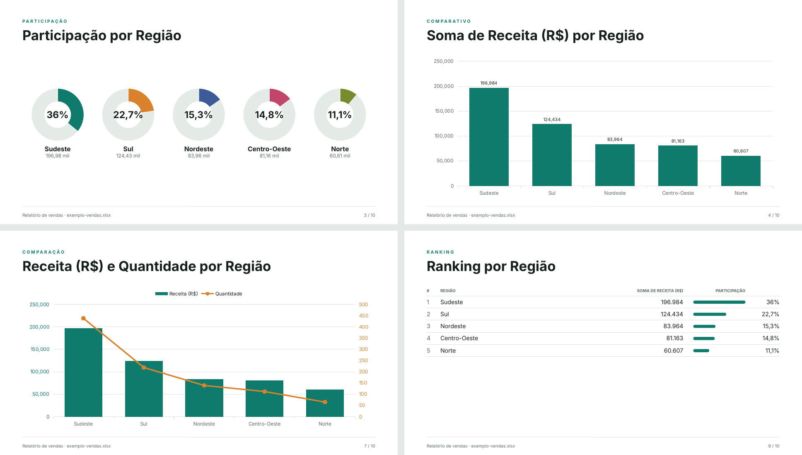

<p align="center">
  
</p>

<h1 align="center">Prisma Reports — relatórios visuais a partir de planilhas</h1>

<p align="center">
  Envie um <strong>Excel ou CSV</strong> e receba na hora um relatório com indicadores, percentuais e gráficos.<br />
  Monte a apresentação na própria página e baixe os slides em PDF ou PowerPoint.
</p>

<p align="center">
  <strong>Português</strong> · <a href="README.en.md">English</a> · <a href="README.es.md">Español</a>
</p>

<p align="center">
  
  
  
  
  
</p>


## Sobre o projeto

O Prisma Reports transforma uma planilha em um relatório visual sem que ninguém precise
montar gráficos à mão. A pessoa envia o arquivo, escolhe o que quer analisar, ajusta os
slides e baixa a apresentação pronta em PDF ou PowerPoint.

Tudo roda no navegador. Os dados não são enviados a nenhum servidor.

### Objetivos

- Ler qualquer planilha com cabeçalho na primeira linha, sem configuração.
- Mostrar os números mais importantes de forma clara e visual.
- Deixar a pessoa mudar a análise (agrupamento, valor, cálculo) e ver o resultado na hora.
- Gerar uma apresentação em PDF ou PowerPoint igual à prévia, pronta para enviar ou apresentar.

## Funcionalidades

- **Upload de Excel e CSV:** `.xlsx`, `.xls` e `.csv`, arrastando o arquivo para a página
  ou pelo botão **Abrir planilha**. Planilhas com várias abas mostram um seletor de aba.
- **Detecção automática das colunas:** cada coluna é reconhecida como número, data,
  categoria ou texto, inclusive no formato brasileiro (`1.234,56`, `R$ 10,00`,
  `dd/mm/aaaa`). CSV com `;`, `,` ou tabulação, em UTF-8 ou Windows-1252.
- **Painel:** indicadores, anéis de percentual, gráficos de barras, rosca e linha do tempo,
  destaques escritos automaticamente e a prévia da tabela.
- **Análise dinâmica:** escolha por qual coluna agrupar, qual valor usar e se o cálculo é
  soma, média ou contagem. Painel e slides se atualizam na hora.
- **Editor de slides:** prévia de todos os slides na página, com a opção de mudar a ordem
  e ocultar slides. O que aparece na prévia é exatamente o que vai para o PDF.
- **Filtros:** limite o relatório a um período (de um mês a outro, pela coluna de data) e
  a alguns valores de uma categoria. Painel, slides e PDF mostram só as linhas filtradas e
  indicam o filtro usado.
- **Textos editáveis:** clique no título de qualquer slide ou num destaque, na prévia, e
  reescreva. Apagar o texto volta ao automático, e **Restaurar textos automáticos** desfaz
  todas as edições.
- **Comparação entre duas colunas:** em **Comparar com**, escolha uma segunda coluna
  numérica para ver as duas lado a lado por grupo, cada uma no seu eixo.
- **Três temas:** Prisma, Executivo e Vibrante, cada um com suas cores e fontes, escolhidos
  numa lista suspensa. O tema vale para a página, os slides e o PDF.
- **Slides em PDF e PowerPoint:** apresentação 16:9 com capa, indicadores, participação,
  barras, distribuição, evolução por mês, comparação, destaques, ranking e tabela de detalhes.
  O botão **Baixar slides** oferece os dois formatos. No `.pptx`, títulos, textos, gráficos e
  tabelas são elementos nativos do PowerPoint: dá para editar o texto, mudar cores e abrir os
  dados de cada gráfico no PowerPoint, no Keynote ou no Google Apresentações.
- **Templates:** em **Template → Salvar template**, as escolhas do relatório vão para um arquivo
  `.prisma.json`: colunas, cálculo, tema, filtro de categoria, ordem e slides ocultos e títulos
  editados. No mês seguinte, abra a planilha nova e use **Template → Abrir template** para
  refazer o mesmo relatório com os números novos. A planilha nunca entra no arquivo, e o
  período e os destaques reescritos ficam de fora, porque mudam a cada mês. Se faltar alguma
  coluna na planilha nova, a página avisa e usa a escolha automática.
- **Português, inglês e espanhol:** as bandeiras no canto superior direito trocam o idioma
  da página, dos slides, dos destaques e do formato dos números e datas. Os dados de exemplo
  também mudam de idioma, com os nomes das colunas e dos valores traduzidos. A escolha fica
  salva no navegador; na primeira visita, vale o idioma do navegador.
- **Tema claro e escuro:** a página segue o tema do sistema.
- **Responsivo:** funciona no computador e no celular.

## Telas

### Editor de slides e temas


| Escolha do tema | Painel no modo escuro |
| --- | --- |
|  |  |

| Temas Prisma, Executivo e Vibrante |
| --- |
|  |
|  |

### Filtros e edição de textos


### Idiomas e download


| Painel em espanhol | Download em PDF ou PowerPoint |
| --- | --- |
|  |  |

### Templates


### PowerPoint editável



### Painel

| Gráficos e destaques | Tabela de dados |
| --- | --- |
|  |  |

### Slides em PDF (tema Prisma)

| Capa | Indicadores |
| --- | --- |
|  |  |

| Participação | Comparativo em barras |
| --- | --- |
|  |  |

| Distribuição | Evolução por mês |
| --- | --- |
|  |  |

| Destaques | Ranking |
| --- | --- |
|  |  |

| Comparação entre duas colunas | Detalhes |
| --- | --- |
|  |  |

### Celular

| Início | Indicadores | Slides |
| --- | --- | --- |
|  |  |  |

## Tecnologias

| Tecnologia | Para que serve |
| --- | --- |
| [React](https://react.dev/) | Componentes da interface e um componente por tipo de slide |
| [TypeScript](https://www.typescriptlang.org/) | Código com tipagem, mais seguro de manter |
| [Vite](https://vite.dev/) | Servidor de desenvolvimento e geração da versão final |
| [SheetJS](https://sheetjs.com/) | Leitura de arquivos Excel e CSV |
| [Chart.js](https://www.chartjs.org/) | Gráficos de barras, rosca e linha |
| [html-to-image](https://github.com/bubkoo/html-to-image) e [jsPDF](https://github.com/parallax/jsPDF) | Captura dos slides e montagem do PDF |
| [PptxGenJS](https://gitbrent.github.io/PptxGenJS/) | PowerPoint com textos, gráficos e tabelas editáveis |
| [Fontsource](https://fontsource.org/) | Fontes dos temas embutidas no projeto |

O projeto não usa banco de dados, login nem servidor. A versão final é um conjunto de
arquivos estáticos, publicada no GitHub Pages a cada atualização da branch `main`.

## Como rodar no seu computador

Você vai precisar do [Node.js](https://nodejs.org/) 20 ou mais recente.

```bash
git clone https://github.com/vidaltechnologies/prismareports.git
cd prismareports
npm install
npm run dev
```

Depois, abra http://localhost:5173. A página abre com dados de vendas de exemplo. Para
testar com outro arquivo, use `exemplos/despesas-por-departamento.csv`.

Outros comandos:

| Comando | O que faz |
| --- | --- |
| `npm run build` | Gera a versão final em `dist/` |
| `npm run preview` | Roda a versão final gerada pelo `build` |
| `npm run build:single` | Gera um único `index.html` com tudo embutido, em `dist-single/` |
| `npm run typecheck` | Verifica os tipos do código |

### Publicação

O workflow `.github/workflows/deploy.yml` publica o site no GitHub Pages sempre que a
`main` é atualizada. Para ativar, em **Settings → Pages** do repositório, escolha
**GitHub Actions** como origem.

## Estrutura do código

```
src/
├── main.tsx                # Ponto de entrada
├── App.tsx                 # Estado da página: dados, configurações, tema, idioma, slides e exportação
├── i18n.ts                 # Textos da interface em português, inglês e espanhol
├── themes.ts               # Os três temas (cores e fontes)
├── styles.css              # Estilos da página e dos slides
├── components/
│   ├── Uploader.tsx        # Área para soltar ou escolher a planilha
│   ├── Controls.tsx        # Título, aba, agrupamento, valor, comparação e linha do tempo
│   ├── FiltersBar.tsx      # Filtros por período e por categoria
│   ├── Dashboard.tsx       # Aba Painel
│   ├── SlideEditor.tsx     # Aba Slides: prévia, ordem e slides ocultos
│   ├── ThemePicker.tsx     # Lista suspensa de temas
│   ├── LanguageSwitcher.tsx # Bandeiras para trocar o idioma
│   ├── MenuButton.tsx      # Botões com menu: Template e Baixar slides
│   ├── ScaledSlide.tsx     # Slide de 1280×720 encolhido para caber na tela
│   ├── ExportStage.tsx     # Renderiza os slides em tamanho real para o PDF
│   ├── ChartCanvas.tsx     # Gráfico do Chart.js como componente
│   └── Ring.tsx            # Anel de percentual em SVG
├── slides/
│   └── slides.tsx          # Um componente por tipo de slide e a lista de slides
└── lib/
    ├── parse.ts            # Leitura da planilha e detecção dos tipos de coluna
    ├── report.ts           # Agrupamentos, totais, série mensal e destaques
    ├── charts.ts           # Configuração dos gráficos
    ├── exportSlides.ts     # Captura dos slides, geração do PDF e download
    ├── pptx.ts             # PowerPoint com elementos nativos, slide a slide
    ├── template.ts         # Salvar, validar e aplicar templates (.prisma.json)
    ├── format.ts           # Números, percentuais e datas no idioma escolhido
    └── sample.ts           # Dados de exemplo, nos três idiomas
exemplos/                   # Planilha de teste
docs/                       # Logo e imagens usadas neste README
```

---

© Vidal Technologies. Todos os direitos reservados.
